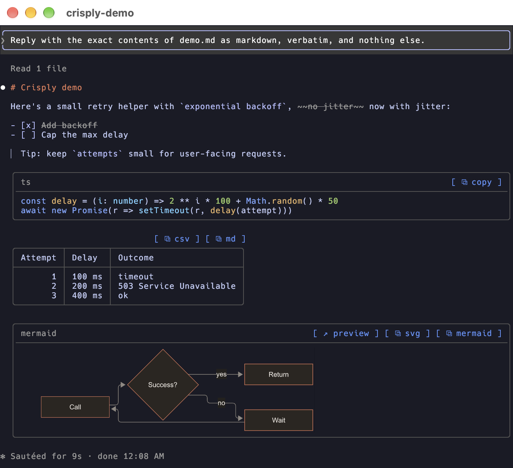

<p align="center"></p>

# Crisply

Sharper Claude Code replies, right in your terminal. Crisply frames code and tables, adds one-click copy buttons, and draws Mermaid diagrams instead of leaving them as source.



## Install

1. Install merman-cli, which Crisply needs to draw diagrams. Everything else works without it.

   ```sh
   brew install merman-cli
   ```

   On Linux, you can use `cargo binstall merman-cli`, or follow [merman-cli installation guide](https://github.com/Latias94/merman/blob/main/crates/merman-cli/README.md#install).

2. Install the plugin from Claude Code:

   ```text
   /plugin install cc-crisply --marketplace layxdd/cc-crisply
   ```

## Features

- **Code blocks** get a rounded frame, a language header and a `[ ⧉ copy ]` button.
- **Tables** fit the terminal's width, wrap long cells, and get `[ ⧉ csv ]` and `[ ⧉ md ]` buttons.
- **Mermaid diagrams** are drawn by [merman-cli](https://github.com/Latias94/merman), as pictures where the terminal can show them and box-drawing text elsewhere. Each one has:
  - `preview`, which opens merman's SVG in your browser
  - `svg` and `mermaid` buttons that copy the picture or its source

- **Your prompts** sit inside a border in the theme's primary blue, on their own background.
- **Headings, inline code, strikethrough, task lists and quotes** get small touches. Everything else looks as Claude Code draws it.

## Pictures or text

With **Diagram display** set to `auto`, diagrams are pictures in:

| Terminal | When |
| --- | --- |
| Ghostty | always |
| kitty | always |
| iTerm2 3.5 and later | in the fullscreen layout |

They are box-drawing text everywhere else, including inside tmux, zellij and screen.

## Configuration

Open `/config` and find **Crisply**:

| Setting | Options | Default |
| --- | --- | --- |
| **Diagram display** | `auto`: pictures where the terminal supports them (see above), text elsewhere<br>`text`: box-drawing text everywhere<br>`code`: the Mermaid source | `auto` |
| **Diagram theme** | `auto`: follow the Claude Code theme (or the terminal's background with Claude Code's `auto` theme)<br>`dark`<br>`light` | `auto` |
| **Prompt border** | on: your prompts in a border<br>off: as Claude Code draws them | on |

## Development

Start a session with the plugin loaded from this folder. It reloads on every edit and writes the type definitions to `.claude-plugin/types/`:

```sh
claude --plugin-dir .
```

From the repository root:

```sh
claude plugin test .                         # run the tests in tests/
claude plugin validate .                     # check manifests and hooks module (add --strict for warnings)
npx -p typescript@5 tsc -p .                 # type-check
npx @biomejs/biome@2.2.4 check --write .     # lint and format
```

| Path | What it holds |
| --- | --- |
| `hooks/register.tsx` | The renderer: frames, buttons, prompts, diagram display |
| `hooks/parse.ts` | Splits a reply's markdown into blocks and inline runs |
| `hooks/layout.ts` | Text width, wrapping and table layout |
| `hooks/merman.ts` | Runs merman-cli and caches its pictures, text and SVGs |
| `hooks/textart.ts` | Crisply's own box art for pie charts and mindmaps |

## License

[MIT](LICENSE)
