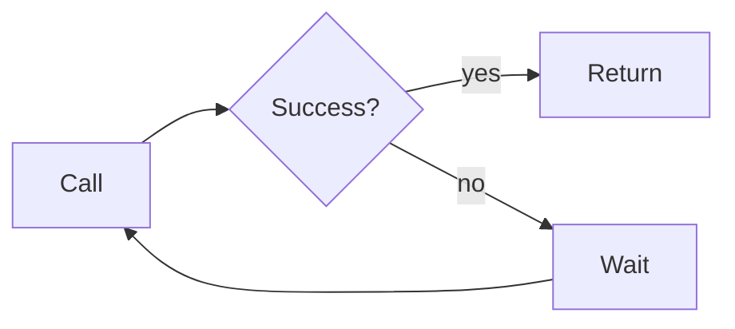

# Crisply demo

Here's a small **retry helper** with `exponential backoff`, ~~no jitter~~ now with jitter:

- [x] Add backoff
- [ ] Cap the max delay

> Tip: keep `attempts` small for user-facing requests.

```ts
const delay = (i: number) => 2 ** i * 100 + Math.random() * 50
await new Promise(r => setTimeout(r, delay(attempt)))
```

| Attempt | Delay | Outcome |
| --- | --- | --- |
| 1 | 100 ms | timeout |
| 2 | 200 ms | `503 Service Unavailable` |
| 3 | 400 ms | ok |


